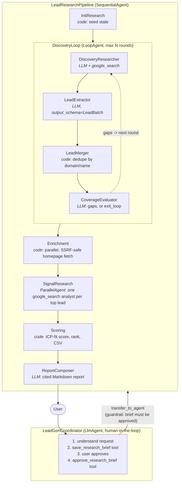

# Part A - Deep Research Lead-Generation Agent (Google ADK)

A multi-agent system that turns *"find me customers for X"* into a researched, scored and cited
list of B2B leads. It follows the deep-research pattern from Google's ADK write-up
(plan -> human approval -> iterative research -> synthesis with citations) and applies it to sales
prospecting.

Inspired by: [Build a deep research agent with Google ADK](https://cloud.google.com/blog/products/ai-machine-learning/build-a-deep-research-agent-with-google-adk)
and [MagnIeeT/leadGenerationAgentADK](https://github.com/MagnIeeT/leadGenerationAgentADK). This is an
independent implementation: different domain (sales leads, not investment leads), different graph,
and deterministic stages for everything that does not need an LLM.

## Architecture



### Design decisions worth knowing

| Decision | Why |
|---|---|
| Researcher -> Extractor split | ADK's built-in `google_search` can't be combined with `output_schema`; free-text research first, structured extraction second. |
| Deterministic stages are `BaseAgent`s | Merge/dedupe, page fetching, scoring and CSV export are code: cheap, reproducible, unit-tested. The LLM never computes the score. |
| Evaluator calls `exit_loop` | LLM judges coverage/diversity; `max_iterations` bounds cost regardless. |
| Dynamic `ParallelAgent` | The number of per-lead analysts is only known at run time. Instructions are passed as callables so company names containing `{}` cannot break ADK's `{placeholder}` templating. |
| Approval guardrail | `before_agent_callback` on the pipeline refuses to run unless the user-approved brief is in state - the prompt asks nicely, the code enforces. |
| Safe fetching | LLM-produced URLs are untrusted: http(s) only, DNS-resolved and rejected if private/loopback/link-local, redirects re-validated per hop, size and time capped. |
| State via `state_delta` events | Persists correctly under any `SessionService`, not just in-memory. |
| `SequentialAgent`/`LoopAgent`/`ParallelAgent` | ADK 2.x marks them deprecated in favour of `Workflow`, but `Workflow` cannot yet be an `LlmAgent` sub-agent, which this coordinator design needs. Revisit when that lands. |

Scoring (0-100): industry 30, region 20, buy signals 25, contactability 15, evidence 10. See
[`tools/scoring.py`](lead_gen_agent/tools/scoring.py).

## Project layout

```
lead_gen_agent/
  agent.py          root_agent (what `adk web` loads)
  pipeline.py       builds the agent graph; `Models` lets tests inject fake LLMs
  stages.py         deterministic BaseAgent stages + dynamic parallel signal research
  prompts.py        every prompt
  schemas.py        ResearchBrief / Lead / LeadBatch
  config.py         env config + shared state-key names
  tools/            brief.py (function tools), web.py, scoring.py, export.py
tests/              22 offline tests, scripted FakeLlm (no API key)
scripts/run_pipeline.py   terminal runner that prints an execution trace
examples/offline_trace.txt  captured trace of the scripted run
```

## Setup

```bash
cd a-lead-generation-agent
python -m venv .venv && source .venv/bin/activate      # Windows: .venv\Scripts\activate
pip install -e ".[dev]"
cp .env.example .env     # add GOOGLE_API_KEY (or Vertex AI settings)
```

## Run

**Interactive UI (recommended for the demo)**
```bash
adk web          # run from this folder, pick "lead_gen_agent" in the dropdown
```
(The dropdown also lists `tests` because it is a Python package - ignore it.)
Then chat: *"Find leads for my fraud-detection API aimed at fintechs in India and Singapore. 5 leads."*
Review the brief, reply *"go"*, and watch the Trace tab as the loop, parallel analysts and report run.

**Terminal**
```bash
python scripts/run_pipeline.py "Find leads for ..."          # live, asks you to approve
python scripts/run_pipeline.py --yes "Find leads for ..."    # live, auto-approve
python scripts/run_pipeline.py --offline                     # scripted models, no key, no network
```

**Tests** (no API key needed)
```bash
pytest
```

## Execution walkthrough

Captured from `python scripts/run_pipeline.py --offline` (full trace in
[`examples/offline_trace.txt`](examples/offline_trace.txt)). The LLM replies there are scripted and
the lead data is invented; what is real is the ADK execution: routing, state, loop, parallelism.

1. **Turn 1** - coordinator calls `save_research_brief` (state: `research_brief`, `brief_text`,
   `brief_approved=False`) and asks for approval. Nothing expensive has run.
2. **Turn 2** - user approves. Coordinator calls `approve_research_brief`, then
   `transfer_to_agent("LeadResearchPipeline")`. The guardrail callback passes.
3. **InitResearch** seeds `leads`, `target_count`, `round_target`, ... so later prompts always resolve.
4. **DiscoveryLoop, round 1** - researcher (search) -> extractor (structured) -> merger
   (`2 extracted, 2 new`) -> evaluator writes *gaps* into `research_gaps`.
5. **Round 2** - the researcher's prompt now contains the gaps and the "already found" list. Merger
   reports `2 extracted, 1 new, 3 total` (a duplicate `PayNova Ltd` was collapsed by domain).
   Evaluator calls `exit_loop`; the loop escalates.
6. **Enrichment** fetches homepages concurrently; 1/3 succeeded (others failed gracefully).
7. **SignalResearch** fans out `SignalAnalyst_0..2` in parallel, each with `google_search`.
8. **Scoring** ranks, writes the CSV, builds the table + evidence blocks.
9. **ReportComposer** writes the final cited report from those blocks only.

## Live run notes

Offline tests prove the wiring; they cannot prove research *quality*. For a live run you need a
Gemini key or Vertex AI project. Expect 2-4 minutes and roughly 15-40 model calls for a 5-10 lead
run. Tune `LEADGEN_MAX_ITERATIONS`, `LEADGEN_DEEP_DIVE_TOP_N` and the model env vars to trade cost
for depth. Contact emails are scraped from public pages and must be verified before outreach;
respect each site's terms and applicable privacy/anti-spam law.
