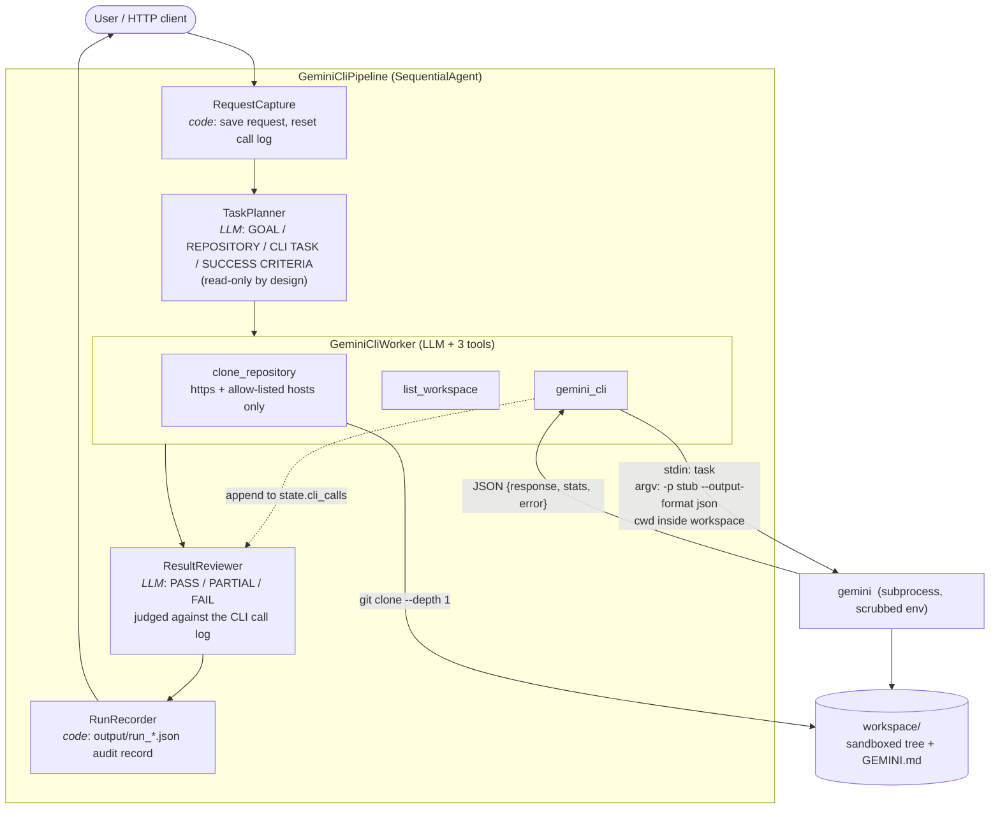

# Part B - Gemini CLI as a Tool Inside an ADK Pipeline

An ADK pipeline that hands the heavy, file-aware work to [Gemini CLI](https://github.com/google-gemini/gemini-cli)
(an agentic coding assistant) through one carefully sandboxed tool, then checks what came back.
Ask it *"explain the architecture of https://github.com/acme/widgets"* and it plans the task, clones the
repo into a quarantined workspace, runs `gemini` headlessly on it, and has a reviewer judge the result
against a ground-truth log of what actually ran.

Inspired by [derrickchwong/gemini-cli-on-adk](https://github.com/derrickchwong/gemini-cli-on-adk) and the
accompanying article. This is an independent implementation. The reference is one agent with one
`subprocess.run(shell=True)` call; this version adds the planning and review stages, a
hardened tool (no shell, path/URL allow-lists, timeouts, output caps, scrubbed environment, audit trail),
an HTTP service and an offline-testable design.

## Architecture



### Design decisions worth knowing

| Decision | Why |
|---|---|
| Task goes to the CLI on **stdin**; `-p` carries a fixed stub | `gemini` on Windows is a `.cmd` shim run by `cmd.exe`: `&`, `%`, quotes in an argument would be command injection, and argv has length limits. Stdin has neither problem (the CLI appends `-p` text to stdin). |
| No `shell=True`, argv list only | The reference interpolates LLM text into a shell string. Never do that. |
| Allow-listed workspace | The LLM picks the `subdirectory`; it is resolved and must stay inside `GEMCLI_WORKSPACE` (rejects absolute paths, `..`, drive letters, symlinks/junctions that point out). |
| `clone_repository`: https + host allow-list | No `ssh`, `file://`, `ext::` transport helpers, credentials or query strings; `--` before the URL; `GIT_TERMINAL_PROMPT=0`. |
| Read-only by default | `--approval-mode default` means anything needing confirmation (writes, shell) is denied in headless mode. `yolo` needs **two** opt-ins. The planner is also told to plan read-only work. |
| Scrubbed environment | Only PATH/HOME-style variables and Gemini auth variables reach the subprocess; other secrets in the parent environment do not. |
| Hard timeout + output caps | Process killed on timeout; stdout/stderr read with a cap; answer truncated to `GEMCLI_MAX_OUTPUT_CHARS` and flagged `truncated`. |
| Audit log in state | Every call is appended to `state.cli_calls`. The reviewer prompt includes it as ground truth ("the CLI never ran, so this is not an analysis"), and `RunRecorder` writes it to disk. |
| Deterministic stages are `BaseAgent`s | Capturing the request and writing the record are code, not LLM calls. |
| Instructions are callables | Repo text and plans often contain `{braces}`; ADK's `{placeholder}` templating would choke. `pipeline._fill` substitutes in a single pass. |

## Quick start

```bash
cd b-gemini-cli-tool-agent
python -m venv .venv && source .venv/bin/activate        # Windows: .venv\Scripts\activate
pip install -e ".[dev]"

pytest                                   # 61 tests, offline: fake gemini executable + scripted LLMs
python scripts/run_pipeline.py --offline # the whole pipeline end to end, no key and no CLI needed
```

### Live run (free)

1. **Install Gemini CLI**: `npm install -g @google/gemini-cli` (Node 20+).
2. **Authenticate the CLI** (free options, pick one):
   - *Login with Google*: run `gemini` once and choose "Login with Google" (personal account, free tier).
   - *Free API key*: create one at <https://aistudio.google.com/apikey> and set `GEMINI_API_KEY`.
3. **Authenticate the orchestrator** (the ADK agents): `cp .env.example .env`, set `GOOGLE_API_KEY`
   (the same free AI Studio key works), or choose Ollama/Groq/OpenRouter (below).
4. Check the tool alone, then run the pipeline:

```bash
python scripts/run_pipeline.py --cli-only "Reply with the single word: ready"    # verifies install + auth
python scripts/run_pipeline.py "Explain the architecture of https://github.com/google/adk-samples ... "
adk web                                  # or the ADK dev UI (select gemini_cli_agent)
```

Orchestrator backends (`GEMCLI_PROVIDER`): `gemini` (free AI Studio tier, default), `ollama` (local,
`ollama_chat/qwen3:8b`), `groq`, `openrouter`, `litellm`. Details in `.env.example`; non-Gemini ones need
`pip install -e ".[local]"`.

### HTTP service

```bash
GEMCLI_SERVER_TOKEN=change-me uvicorn server:create_app --factory --port 8080
curl -s localhost:8080/healthz
curl -s localhost:8080/analyze -H "Authorization: Bearer change-me" -H "Content-Type: application/json" \
     -d '{"request": "Summarise the architecture of https://github.com/acme/widgets"}'
```

`/analyze` returns `{verdict, answer, plan, cli_calls, run_record}`. The standard ADK endpoints (`/run`,
`/run_sse`, `/list-apps`, ...) are served alongside. Set `GEMCLI_SERVER_TOKEN` for anything non-local.

### Docker / Cloud Run

`Dockerfile` bundles Node + Gemini CLI + the ADK service and runs as a non-root user. Pass keys at run
time (`-e GOOGLE_API_KEY=... -e GEMINI_API_KEY=... -e GEMCLI_SERVER_TOKEN=...`). To deploy on Cloud Run:
`gcloud run deploy gemini-cli-agent --source . --region <r> --set-secrets ...` (requires `gcloud` and a
billing-enabled project, so this is documented rather than required). On Cloud Run, mount a writable
volume or accept that `/app/workspace` is ephemeral per instance.

## Execution walkthrough

Real output of `python scripts/run_pipeline.py --offline` (LLM replies and the CLI are scripted stand-ins;
everything in between is the real code path; also saved in [examples/offline_trace.txt](examples/offline_trace.txt)):

```
>>> USER: Give me an inventory of the files in the sample project.
      state += ['cli_calls', 'user_request']                      <- RequestCapture (code)
  [TaskPlanner] GOAL: Give an inventory ... REPOSITORY: none CLI TASK: List every file ...
      state += ['task_plan']
  [GeminiCliWorker] -> tool call list_workspace({'subdirectory': '.'})
  [GeminiCliWorker] <- list_workspace: status=ok
  [GeminiCliWorker] -> tool call gemini_cli({'task': 'List every file in this directory ...', 'subdirectory': 'sample_project'})
  [GeminiCliWorker] <- gemini_cli: status=ok                      <- subprocess ran in workspace/sample_project
      state += ['cli_calls']
  [GeminiCliWorker] Gemini CLI inventory (relayed unchanged) ... Source: Gemini CLI, sample_project
      state += ['worker_result']
  [ResultReviewer] VERDICT: PASS CHECKS: every file mentioned - met ...
      state += ['review']
  [RunRecorder] Run record written to output\run_....json
```

Step by step:

1. **RequestCapture** stores the user message in `state.user_request` (later stages don't see chat history)
   and empties `state.cli_calls`, so a reused session can't inherit a previous run's audit log.
2. **TaskPlanner** writes a structured plan. Nothing executes yet; it only decides *what* Gemini CLI
   should be asked, and whether a repository is needed.
3. **GeminiCliWorker** follows the plan with its tools. `clone_repository` validates the URL and does a
   shallow clone into `workspace/repos/<owner>__<repo>`; `gemini_cli` validates the `subdirectory`, spawns
   `gemini -p "<stub>" --output-format json --approval-mode default` there with the task on stdin, enforces
   the timeout/caps, parses `{response, stats, error}` and returns a `status` of `ok`, `error`, `timeout`,
   `rejected` or `not_installed`. On anything but `ok` the worker is told not to invent an answer.
4. **ResultReviewer** gets the request, plan, worker result **and the call log**. A confident-sounding
   answer after a failed or missing CLI call is marked FAIL.
5. **RunRecorder** writes `output/run_<timestamp>.json` (request, plan, every call, review).

## Tests (`pytest`, 61, no network, no CLI, no key)

| File | What it proves |
|---|---|
| `test_gemini_cli_tool.py` | Against a **fake `gemini` executable** (`tests/fake_gemini.py`): success, JSON/plain/noisy output parsing, non-zero exit, exit 42, API-error JSON, timeout kills the process, requested timeout is capped, oversized output truncated, task arrives via stdin and never in argv (injection payloads), env scrubbing, path escapes (`..`, absolute, UNC, symlink/junction), yolo double opt-in, not-installed message, concurrent calls. |
| `test_workspace.py` | URL allow-list (ssh, `file://`, `ext::`, credentials, other hosts, `-flag` names), git invoked with the right argv and `GIT_TERMINAL_PROMPT=0`, cache hit, cleanup on failure, `GEMINI.md` installed once. |
| `test_pipeline_e2e.py` | The real ADK graph with scripted LLMs: planner/worker/reviewer prompts contain the right state (and survive `{braces}`), tool results flow back, CLI failure and sandbox rejection are visible to the reviewer, run record on disk, call log reset between runs. |
| `test_server.py` | `/healthz`, `/analyze`, validation, bearer-token enforcement, ADK routes present. |

## What was and was not verified

- **Verified**: everything above, via the offline suite and the offline demo.
- **Verified against docs, not a live install**: the CLI flags (`-p`, `--output-format json`, `-m`,
  `--approval-mode`, `--sandbox`, `--skip-trust`), the JSON schema `{response, stats, error}` and exit codes
  (0, 1, 42, 53) come from the Gemini CLI docs; Gemini CLI was **not installed** on the development
  machine (no live run). Run `--cli-only` first on your machine. If your CLI version differs, adjust
  `build_argv` in [gemini_cli.py](gemini_cli_agent/tools/gemini_cli.py).
- **Unverified**: that stdin-plus-`-p` stub behaves identically on every CLI release (documented: "appended
  to stdin"); the Docker image was not built; Cloud Run deploy was not run.
- Gemini CLI can still be steered by prompt injection inside a cloned repo. The defences are layers:
  read-only approval mode, the workspace jail, the scrubbed environment, and the reviewer. For untrusted
  repos also enable `GEMCLI_SANDBOX=1`.
