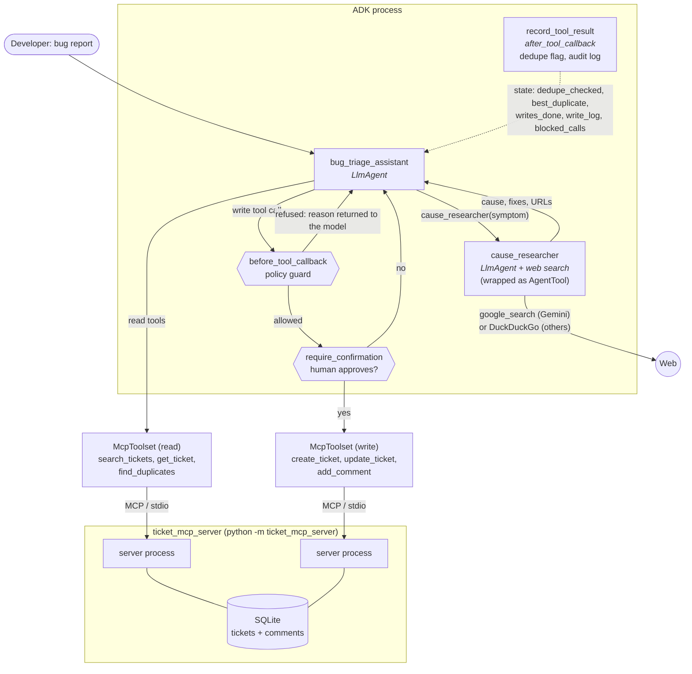

# Part C - MCP-Tools Bug Triage Assistant

An ADK agent that triages a bug report against a ticket tracker, **where the tracker is a separate MCP
server** that the agent discovers at runtime. It checks for duplicates first, researches the probable cause
on the web, proposes a fix, and files or comments on a ticket - but only after a human approves each write,
and only if a set of policy guardrails agrees.

Inspired by the `software-bug-assistant` sample in [google/adk-samples](https://github.com/google/adk-samples) and the
MCP Toolbox for Databases material; this is an independent implementation (own server, own store, own guardrails;
SQLite instead of Cloud SQL / a hosted database, so it runs with nothing to provision).

## What is MCP, and why use it here

The **Model Context Protocol** is an open standard for publishing tools to agents: a *server* declares tools
(name, description, JSON schema); any *client* (ADK, Claude, an IDE) connects, lists them and calls them.
Here the ticket tracker is an MCP server (`ticket_mcp_server/`) and the ADK agent is a client
(`McpToolset`). The agent package never imports the server code - the only contract is the protocol.
So the same server can be reused by a different agent framework, or the agent can swap in a different MCP server
(GitHub issues, Jira) without code changes beyond the connection parameters.

## Architecture



### The workflow the agent follows

1. **Understand** the report (symptom, error text, component).
2. **Dedupe first**: `find_duplicates` (deterministic token-overlap scoring, no LLM). A score of 0.6 or more means
   "very likely the same problem": read the ticket (`get_ticket`) - resolutions usually live in comments.
3. **Duplicate** -> explain, and (with approval) `add_comment` the new occurrence. No new ticket.
4. **New** -> `cause_researcher` searches the web; the agent writes probable cause + concrete fix + sources.
5. **File it** -> `create_ticket` (symptom-first title; repro, cause, fix, sources; priority and component).

### Design decisions worth knowing

- **Two toolsets over one server.** `require_confirmation` is a per-toolset switch, so read tools (no approval)
  and write tools (approval) are separate `McpToolset`s selected with `tool_filter`; each spawns the server over
  stdio. They share one SQLite file. The server seeds the demo data inside a single `BEGIN IMMEDIATE`
  transaction so two processes starting together cannot double-seed (there is a test for the idempotence).
- **Human-in-the-loop is ADK's own mechanism.** A write call pauses the run with an `adk_request_confirmation`
  event; the client answers with `{"confirmed": true|false}` (see `bug_assistant/runner.py`). Rejection is returned to
  the model as a tool result so it can explain, not crash.
- **Policy guardrails run *before* the human is asked** (`bug_assistant/guardrails.py`), so people never review a
  request that already breaks the rules: create only after a duplicate check; no create when the latest duplicate
  check found a >= 0.6 match (comment on it instead; threshold `BUGASSIST_DUP_BLOCK`); no secrets/keys in ticket
  text (private keys, AWS/Google/GitHub/Stripe keys, bearer tokens, `NAME = value` credentials; masked values such
  as `<redacted>` pass); the agent may not set status `closed` (humans only); at most `BUGASSIST_MAX_WRITES`
  (3) successful writes per session. A refusal is a dict returned to the model with the reason and recorded in
  `state.blocked_calls`; successful writes go to `state.write_log` (audit trail).
- **The write-tool list is defined once**, in `ticket_mcp_server/server.py` (`WRITE_TOOLS`), and the guardrail
  imports it, so a new write tool cannot silently bypass the policy.
- **Server errors are data.** Tools return `{"status": "ok" | "error", ...}`; invalid input becomes an error
  result the model can read and fix. All SQL is parameterised (tested with an injection payload); inputs are
  length-limited and validated against enums.
- **Why the researcher is an `AgentTool`.** Gemini's built-in `google_search` cannot be combined with other tools in
  one agent. Wrapping the searcher as its own agent also keeps the long search transcript out of the triage context.
- **Why not embeddings for duplicates.** Explainable and reproducible: the result lists `matched_terms`, and tests
  pin the behaviour. Bug reports are full of distinctive identifiers (exception and endpoint names), which token
  overlap handles well. Swap `similarity.py` if you need semantic matching.
- **mcp 1.x and 2.x.** The server imports `MCPServer` (mcp 2) and falls back to `FastMCP` (mcp 1); ADK supports `mcp>=1.24,<3`.
  Developed and tested on mcp 2.3.0.

## Quick start

```bash
cd c-bug-assistant-mcp-agent
python -m venv .venv && source .venv/bin/activate        # Windows: .venv\Scripts\activate
pip install -e ".[dev]"                                    # add ,local for Ollama/Groq/OpenRouter
pytest                                                     # 62 tests, no API key, no network
python scripts/run_pipeline.py --offline                   # scripted LLMs; real MCP server + guardrails
python scripts/run_pipeline.py --list-tools                # connect to the MCP server, list tools
```

### Live run (free)

```bash
cp .env.example .env     # set GOOGLE_API_KEY (free AI Studio key, no card) - or choose Ollama, below
python scripts/run_pipeline.py "Checkout returns 500 when a product is discontinued"   # asks you to approve each write
adk web                  # chat UI (run from this folder). If it does not pick up your key, copy .env to bug_assistant/.env
```

| Backend | Setup | `BUGASSIST_PROVIDER` | Search |
|---|---|---|---|
| Gemini API free tier (default) | free key from aistudio.google.com/apikey | `gemini` | Google Search grounding |
| Ollama (local, offline) | `ollama pull qwen3:8b`, `pip install -e ".[local]"` | `ollama` | DuckDuckGo (keyless) |
| Groq free tier | `GROQ_API_KEY`, `.[local]` | `groq` | DuckDuckGo |
| OpenRouter `:free` models | `OPENROUTER_API_KEY`, `.[local]` | `openrouter` | DuckDuckGo |

The ticket database lives in `data/tickets.db` (override with `BUGASSIST_DB`) and is seeded with eight demo
tickets for a fictional web shop on first start. Delete the file to reset.

### Try these reports

- *Duplicate:* "Customers get HTTP 500 at checkout when a discontinued product is in the cart" -> comment on #1.
- *New:* "Our Stripe webhook returns 400 signature mismatch since we added express.json()" -> research + new ticket.
- *Policy:* paste a log containing `api_key = ...` and ask it to file the ticket -> refused until masked.

### Optional extras (not required, not tested here)

Add more MCP servers to the agent's `tools=[...]` as extra `McpToolset`s, e.g. the GitHub MCP server for issues
(needs a GitHub token) or MCP Toolbox for Databases in front of Postgres. The guardrail is keyed on tool names,
so extend `WRITE_TOOLS`-style lists for any new write tool.

## Execution walkthrough

Real output of `python scripts/run_pipeline.py --offline` (saved in [examples/offline_trace.txt](examples/offline_trace.txt)).
Model replies and web search are scripted; everything else is real.

**Scenario 1 - duplicate.**

```
>>> USER: Customers get an HTTP 500 at checkout whenever a discontinued product is in their cart...
  -> find_duplicates(...)                       <- status=ok count=1        (ticket #1, score >= 0.6)
  -> get_ticket({"ticket_id": 1})               <- status=ok ticket=#1      (reads the comments: cause already known)
  -> add_comment(...)                           ** PAUSED: approval needed for add_comment
  [human] (auto) approved add_comment           <- status=ok ticket=#1
  "This is a duplicate of ticket #1 ... I did not open a new ticket."
```

**Scenario 2 - new bug, with a guardrail catch.**

```
  -> find_duplicates(...)                       <- count=0
  -> cause_researcher(...)                      <- status=ok PROBABLE CAUSE: Stripe signs the raw request bytes...
  -> create_ticket(...)                         <- status=refused_by_policy  "looks like it contains a payment/webhook secret"
  -> create_ticket(... secret removed ...)      ** PAUSED: approval needed for create_ticket
  [human] (auto) approved create_ticket         <- status=ok ticket=#9
```

What to notice: the refusal happens *before* any human is asked; the pause/approve/resume is a separate event;
the model only claims success after `status=ok`.

## Tests (`pytest`, 62, no network, no key)

| File | What it proves |
|---|---|
| `test_store.py` (22) | SQLite store: seeding idempotent, ranking and `matched_terms`, duplicate detection incl. an unrelated report that must *not* match, validation table, SQL-injection payload is inert, NUL stripping |
| `test_mcp_server.py` (4) | Spawns the real server and speaks MCP: tool list and read-only/write annotations, seeded reads, write persistence across calls, validation errors are results not crashes |
| `test_agent_e2e.py` (12) | The real ADK graph + `McpToolset` + stdio server with scripted LLMs: duplicate -> comment (no new ticket, researcher not called), new bug -> research -> approved create, **rejected approval leaves the DB untouched**, run pauses with no approver, confirmation disabled, and each guardrail (dedupe-first, near-duplicate, secrets then masked retry, no closing, write budget, server validation error) |
| `test_guardrails_and_models.py` (24) | Secret detector true/false positives, MCP result unwrapping, provider/search selection, search failure is data |

## What was and was not verified

Verified here (Windows 11, Python 3.14, google-adk 2.14.1, mcp 2.3.0): everything above, including the real stdio
transport between ADK and the server, the confirmation pause/resume, and the `--offline` trace.
A bug found by running the demo rather than by the unit tests: the secret detector missed prefixed names such as
`webhook_secret = ...` (it only matched a bare `secret`); fixed and now covered by tests.

**Not verified (needs a live LLM):** actual model behaviour. The workflow and guardrails are enforced in code and
tested with scripted models, but whether a free-tier model follows `prompts.TRIAGE` reliably (calls `find_duplicates`
before writing, writes a good ticket) has not been observed. Small local models (8B) may need the prompt tightened.
Also unverified: the `adk web` confirmation UI, and the mcp 1.x fallback import (no mcp 1.x install was tried).
