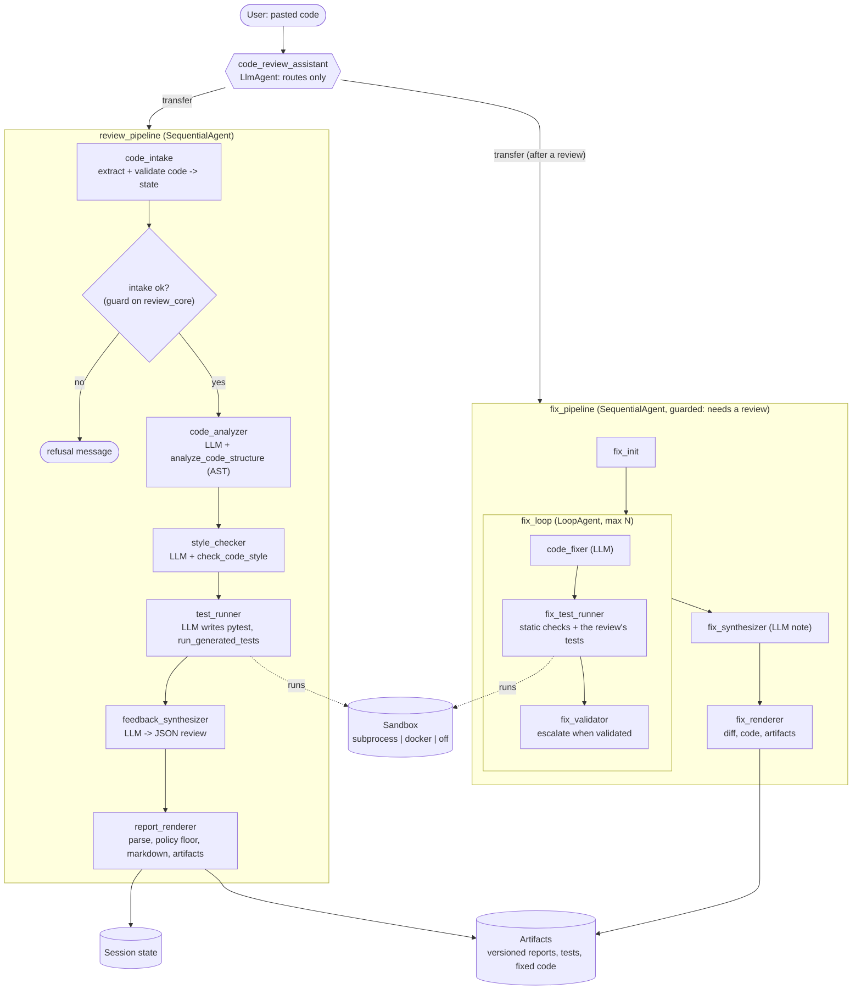

# Part D - Production code-review assistant (Google ADK)

Paste Python code; get a structured review that is backed by evidence, not just model opinion:

1. a deterministic **AST analysis** (functions, complexity, risky constructs such as `eval`, `shell=True`, SQL built with
   `%`, hard-coded keys, mutable defaults),
2. deterministic **style rules** (PEP 8 layout, naming, docstrings, unused imports),
3. **LLM-written pytest tests, executed in a sandbox**, so "this function crashes on an empty list" is a failing test, not a guess,
4. a **structured report** (Pydantic) whose verdict code is allowed to raise but never lower,
5. on request, a **fix loop**: the model proposes a fix, the sandbox re-runs the review's tests, the loop repeats until the tests
   pass or attempts run out, and an unvalidated fix is labelled as such.

Inspired by `ayoisio/adk-code-review-assistant` and its Medium/codelab series (review pipeline + fix pipeline, state and
artifacts, deployable). This is an original implementation, free-first (no paid API needed), and it keeps the
"what must not depend on the model" logic in plain code.

## Architecture



**Design rules** (each is covered by tests):

| Rule | Why | Where |
|---|---|---|
| Stages talk only through session state (`config.K`) | testable, resumable, no hidden channels | `config.py` |
| The code never travels through a tool argument: tools read it from state | a model copying 300 lines into a tool call corrupts it | `tools/analyzer.py`, `tools/style.py` |
| Facts are decided by code, prose by the model | "do the tests pass", "may the loop exit", "which verdict is allowed" must not depend on a model's mood | `report.py`, `stages.py` |
| A model cannot drop a critical finding or approve failing code | the policy floor raises the verdict and re-adds critical/high analyzer findings; policy actions are listed in the report | `report.apply_policy` |
| The model's claims about tests are replaced when nothing ran | a reviewer must not say "tests pass" for code that was never executed | `report.apply_policy` |
| The loop's exit test is deterministic (`FixValidatorAgent` escalates) | Part A already shows the LLM-calls-`exit_loop` pattern; here pass/fail is a fact, so no model call is spent on it | `stages.py` |
| An unvalidated fix is saved as `fixed_code_UNVERIFIED.py` and shown with a warning | never present a draft as a fix | `FixRendererAgent` |
| Bad model JSON degrades to a deterministic report instead of crashing | ADK raises on invalid `output_schema` JSON, so the hard schema is opt-in (`CODEREVIEW_STRICT_SCHEMA=1`) | `schemas.parse_report`, `report.fallback_report` |

## Execution walkthrough (real output, offline)

`python scripts/run_pipeline.py --offline` replaces only the model replies; everything else is real (ADK runner, routing,
tools, the pytest sandbox, the fix loop, artifacts). The full trace is in [examples/offline_trace.txt](examples/offline_trace.txt).

```
>>> USER: Please review this code (20 lines)
  [code_review_assistant] -> transfer_to_agent({"agent_name": "review_pipeline"})
  [code_intake] Received 20 lines of Python.
  [code_analyzer] -> analyze_code_structure({})
  [code_analyzer] <- analyze_code_structure: status=ok findings=3 max_complexity=2
  [style_checker] -> check_code_style({})
  [style_checker] <- check_code_style: status=ok issue_count=5
  [test_runner] -> run_generated_tests({"test_code": "<550 chars>"})
  [test_runner] <- run_generated_tests: status=failed passed=2 failed=2 errors=0     <- a real pytest run
  [feedback_synthesizer] {"verdict": "request_changes", ...}
# Code review (round 1): REQUEST CHANGES        <- findings table, tests, strengths, next steps

>>> USER: Please fix the problems you found.
  [fix_test_runner] Fix attempt 1: 3 passed, 1 failed - rejected          <- the fixer fixed one bug, left the shared default
  [fix_validator] Attempt 1 rejected: another round, up to the iteration limit.
  [fix_test_runner] Fix attempt 2: 4 passed, 0 failed - VALIDATED
  [fix_validator] Fix validated: leaving the loop.
# Fix result: VALIDATED   (unified diff + fixed code)
ARTIFACTS: fixed_code.py, fix_report.md, generated_tests.py, review_report.json, review_report.md
```

Scenario 2 in the same trace shows the guardrails: a lenient scripted reviewer *approves* a module that uses `eval()` and
`subprocess.run(shell=True)`. The sandbox refuses to execute it (`status=refused`), and the report comes out as
`REQUEST CHANGES` with a "Policy notes (applied by code, not by the model)" section listing what was overruled.

### What happens, stage by stage

| Stage | Kind | Reads (state) | Writes |
|---|---|---|---|
| `code_intake` | deterministic | the user message | `code_to_review`, `intake`, `review_round`; resets old review/fix state |
| `code_analyzer` | LLM + AST tool | code | `analysis` (tool), `structure_notes` (LLM) |
| `style_checker` | LLM + rule tool | code | `style_result`, `style_notes` |
| `test_runner` | LLM + sandbox tool | code, structure notes | `generated_tests`, `test_result`, `test_notes`; artifact `generated_tests.py` |
| `feedback_synthesizer` | LLM | analysis, style, test result, all notes | `report_raw` (JSON text) |
| `report_renderer` | deterministic | `report_raw` + all evidence | `review_report`; artifacts `review_report.json/.md` |
| `code_fixer` | LLM | code, findings, tests, last rejection | `fixer_output` |
| `fix_test_runner` | deterministic + sandbox | fixer output, tests, original code | `fixed_code`, `fix_test_result`, `fix_feedback`, `fix_iteration`, `fix_passed` |
| `fix_validator` | deterministic | `fix_passed` | escalates (ends the loop) when validated |
| `fix_synthesizer`, `fix_renderer` | LLM note + deterministic | everything above | `fix_report`; artifacts `fixed_code.py`, `fix_report.md` |

A fix candidate must (a) parse, (b) keep every public function/class name (callers depend on them), (c) contain no
critical/high analyzer finding, and (d) pass the review's tests in the sandbox. If the tests cannot run (sandbox `off`,
or refused), validation falls back to (a)-(c) and says "static checks only" in the result.

## The sandbox, honestly

The submitted code and the tests an LLM wrote for it are both untrusted.

| Mode | Isolation | Use for |
|---|---|---|
| `subprocess` (default) | fresh `python -I`, temp dir that is deleted, scrubbed environment (no API keys, no `PYTHONPATH`, fake `HOME`), hard timeout that kills the whole process tree, output kept to head+tail so a runaway `print` cannot exhaust memory, pytest plugin autoload off, POSIX rlimits (CPU, memory, file size, processes). **Not a security boundary**: the child can still read files the user can read. So code that imports `socket`/`subprocess`/`ctypes`/`requests`..., or calls `eval`/`os.system`/`shutil.rmtree`..., is **refused (reported, not run)** unless `CODEREVIEW_ALLOW_RISKY_EXEC=1` | your own code, local development |
| `docker` | the same run in a container: `--network none --read-only --cap-drop ALL --user 65534 --memory --pids-limit`, workdir mounted read-only. Build the image first (`sandbox/Dockerfile.sandbox`) | code you did not write |
| `off` | never executes anything; the review is static and says so | any deployment that holds credentials (the service `Dockerfile` defaults to this) |

A production deployment should use a managed isolated executor (for example Agent Engine's code execution) rather than either local mode.

## Free backends

| Backend | Setup | Notes |
|---|---|---|
| Gemini API free tier (default) | free AI Studio key -> `GOOGLE_API_KEY`, `CODEREVIEW_PROVIDER=gemini` | built-in retry/backoff for free-tier 429s |
| Ollama (local) | `pip install -e ".[local]"`, `ollama pull qwen3:8b`, `CODEREVIEW_PROVIDER=ollama` | fits an 8 GB GPU; small models follow the JSON format less reliably, which is what the lenient parser and fallback report are for |
| Groq / OpenRouter free tiers | `CODEREVIEW_PROVIDER=groq` or `openrouter` + the provider's key | via LiteLLM |
| No LLM at all | `python scripts/run_pipeline.py --check module.py` | AST + style + evidence-only verdict |

Two model roles: `fast` (routing, notes, summaries) and `coder` (tests, final review, fixer): `CODEREVIEW_MODEL` /
`CODEREVIEW_CODER_MODEL`. Configuration reference: [.env.example](.env.example).

## Run it

```bash
cd d-code-review-assistant
pip install -e ".[dev]"                                   # + ".[local]" for Ollama/Groq/OpenRouter, ".[server]" for the API
pytest -q                                                 # 127 offline tests, no key needed (about 20 s)
python scripts/run_pipeline.py --offline                  # the scripted demo above
python scripts/run_eval.py                                # the offline eval set (11 cases)
cp .env.example .env                                      # add a free GOOGLE_API_KEY
python scripts/run_pipeline.py my_module.py --fix         # live: review, then fix + validate
adk web                                                   # chat UI; root_agent is code_review_assistant
uvicorn server:create_app --factory --port 8080           # HTTP: POST /review {"code": "...", "fix": true}
```

`adk web` lists every package folder (including `tests`); pick `code_review_assistant`.

## Tests and evals

* `tests/test_analyzer_and_style.py`: every risky construct and its safe look-alike, complexity, style rules, intake extraction.
* `tests/test_sandbox.py`: pass/fail/error parsing, timeout kill, bounded output, scrubbed environment, throw-away directory, refusals, docker argv flags.
* `tests/test_schemas_and_report.py`: lenient JSON parsing, the verdict floor, policy corrections, fallback report.
* `tests/test_pipeline_e2e.py`: the whole graph with scripted models: stage order, state, artifacts and their versions, the fix loop (rejection feedback reaches the next prompt, exhaustion, dropped public API, static-only validation), guards.
* `tests/test_eval_server_config.py`: the eval set, the HTTP service (token, size limit), provider selection.
* **Eval set** `tests/eval/cases/*.json` + `code_review_assistant/evals.py`: 11 cases (clean module, secret + SQL injection, mutable default exposed by a failing test, infinite loop killed, network import refused, `eval`/shell, syntax error, complexity, swallowed exceptions, style rules). These pin the behaviour that must not regress whatever model is plugged in. The case format has room for a model-judged section, but no live-model eval ships (no API key was available).

## Deploying (documented, not run)

* `Dockerfile` - the HTTP service. Sandbox defaults to `off` because the service holds credentials.
* `deploy/deploy.sh` - Cloud Run (`--no-allow-unauthenticated`, secrets from Secret Manager, bounded concurrency).
* `deploy/agent_engine_app.py` - Vertex AI Agent Engine.
* `sandbox/Dockerfile.sandbox` - the image for `CODEREVIEW_SANDBOX=docker`.
* Artifacts: `CODEREVIEW_ARTIFACT_DIR` persists to disk (`FileArtifactService`); for GCS swap in `GcsArtifactService` in `runner.make_artifact_service`.

## Verified / not verified

Verified on the author's Windows machine: all 127 tests (including real pytest subprocess runs, timeout kill, bounded output,
environment scrubbing), the offline demo, the eval set, `--check`, the FastAPI endpoints through `TestClient`, multi-turn
routing (review, then "fix it" in the same session reaches `fix_pipeline`), versioned artifacts in memory and on disk.

**Not verified:** any live LLM run (no API key was available): prompts are tested for what they contain, not for what a real
model does with them; `CODEREVIEW_SANDBOX=docker` (Docker Desktop's daemon was not running; only the generated `docker run`
argv is unit-tested); the POSIX resource limits (the dev machine is Windows); the Dockerfiles, `deploy.sh` and
`deploy/agent_engine_app.py` (not built / not run); `CODEREVIEW_STRICT_SCHEMA=1` against real Gemini.

Known limits: Python only; one module per review (no cross-file analysis); the AST rules are heuristics (for example the
SQL check flags any `execute()` whose first argument is built by interpolation); generated tests can be wrong, which is why a
failing test is reported with a "real bug or doubtful test" judgement and why only `failed`/`timeout` (not collection errors)
force `request_changes`.
